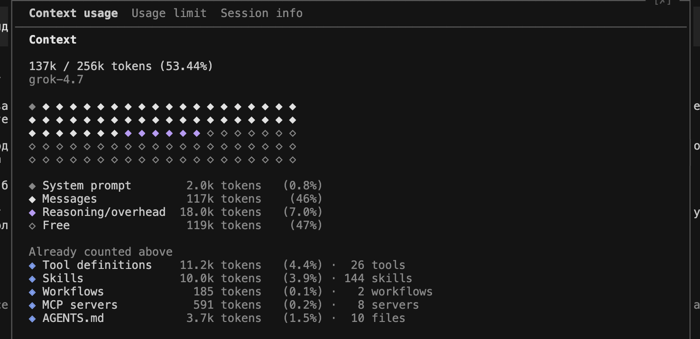
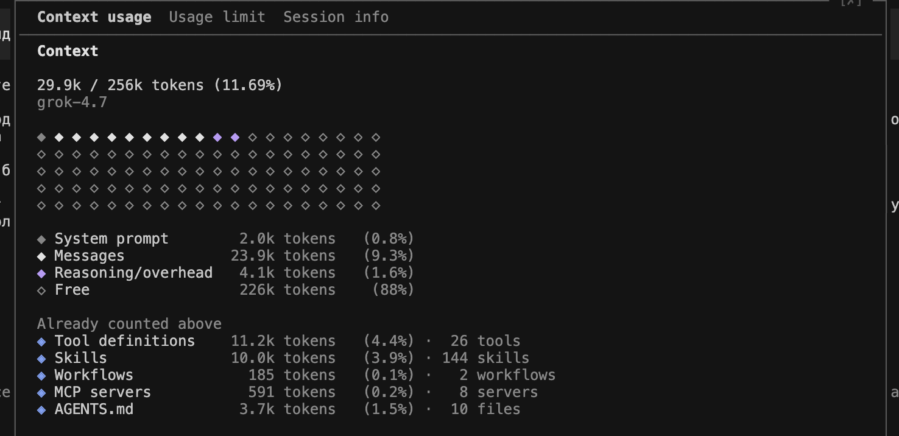

# Telegram-бот «входящие»

Личный бот для заметок и ссылок: теги от модели, поиск, ежедневный дайджест. Один пользователь, доступ по белому списку Telegram ID. Стек: Java 21, Spring Boot, TelegramBots, PostgreSQL в Docker, Maven.

Требования: [`ТЗ-telegram-bot.md`](ТЗ-telegram-bot.md). План и журнал работы: [`docs/plan.md`](docs/plan.md), [`docs/memory.md`](docs/memory.md).

**Статус:** шаг 1 из 7 готов. В `src/` есть `AccessPolicy` и `MessageHandler`. Шаг 2 (приложение, переменные окружения, PostgreSQL, ответ только владельцу) открыт. Этап Discovery в GSD пройден — раздел ниже.

## Как агент работает в проекте

Проект ведётся вместе с кодинг-агентом (Claude Code). Всё, что определяет его поведение, лежит в репозитории.

| Что | Где | Назначение |
|---|---|---|
| Инструкции | `AGENTS.md`, `CLAUDE.md` | Описание проекта, команды, конвенции, запреты. `CLAUDE.md` дополнительно подключает память |
| Правила | `.claude/rules/` | `run-tests-before-done` и `session-memory` загружаются всегда. `tdd` (для `src/**/*.java`, `playground/`), `java-main` (для `src/main`) и `tests` (для тестов) подгружаются только при работе с подходящими файлами |
| Навыки | `.claude/skills/` | `write-tests` агент вызывает сам, когда добавляет фичу или чинит баг; `/review-step` запускается вручную перед слиянием ветки |
| Права | `.claude/settings.json` | Разрешено: тесты, Spotless, безопасные git-команды. Подтверждение: `git push`. Запрещено: чтение `.env`, `rm -rf`, force push, `reset --hard`, удаление томов Docker |
| Hooks | `.claude/hooks/` | `block_protected.py` перед записью блокирует `.env*`, `.git/`, lock-файлы; `block_bash_writes.py` делает то же для Bash-команд (redirect, `tee`, `sed -i`, `rm`, `mv`, `git config`); `check_after_edit.py` после правки запускает Spotless для `.java` (когда есть `pom.xml`), `node --check` для `.js` и разбор `.json` |
| Память | `docs/plan.md`, `docs/memory.md` | План с чекбоксами и журнал «сделано / решение / дальше / ловушки». Агент читает их в начале сессии и обновляет в конце |
| Браузерная проверка | `.mcp.json` | Playwright MCP: агент может открыть страницу, пройти сценарий, снять скриншот и прочитать консоль |

**Режим по умолчанию — `acceptEdits`.** Правки файлов в репозитории применяются без вопросов, потому что их видно в git и они подкреплены TDD-тестами, а команды вне белого списка и `git push` всё равно требуют подтверждения.

**Ограничение защиты.** Hook на Bash работает по тексту команды: он ловит типовые случаи, но не песочница, и его можно обойти косвенно (через переменные, скрипты, `eval`). Он также блокирует любую команду, где встречается `.env`, включая безобидные, например `git commit -m "fix .env"`. Тесты hook'а: `python3 .claude/hooks/test_block_bash_writes.py`.

**Личные настройки** живут в `.claude/settings.local.json` и не попадают в git.

## Эскиз интерфейса и e2e-тесты

`playground/bot-mockup/` содержит кликабельный макет чата (заметка, ссылка, теги кнопками, поиск, дайджест) и e2e-тесты на Playwright. Это учебное упражнение: тесты проверяют макет, а не настоящего бота.

```bash
cd playground/bot-mockup
npm install
npx playwright install chromium
npm test
```

Каждый тест также проверяет, что в консоли браузера нет ошибок. Скриншот сохраняется в `test-results/search.png`.

## Команды бота

Появятся после шага 2 (скелет Spring Boot). Список ведётся в `AGENTS.md`.

## Планирование GSD

3 ноября 2026 прошли этап Discovery в GSD и собрали каталог `.planning/` в этом репозитории, ветка `hw2`.

Discovery здесь — исследование домена до требований и roadmap. Итог — `.planning/research/SUMMARY.md`: проверка сводки прошла, уверенность средняя, предложенные фазы совпадают с шагами 2–7 [`docs/plan.md`](docs/plan.md). Отдельного `DISCOVERY.md` нет: его пишет планирование уже существующей фазы. Требований, `ROADMAP.md` и фаз ещё нет. Стек из ТЗ не менялся.

Коммиты только этих документов, локально, без отправки на GitHub: `f28ff79` (контекст проекта), `294d2c2` (настройки), `e83fe92` (исследование).

### Файлы `.planning/`

| Файл | Содержание |
|---|---|
| `.planning/PROJECT.md` | Что уже сделано, что в работе, что вне рамок |
| `.planning/config.json` | Настройки GSD: режим без лишних подтверждений, исследование включено, документы планирования коммитятся |
| `.planning/research/SUMMARY.md` | Сводка Discovery |
| `.planning/research/STACK.md` | Java 21, Spring Boot 4.1.1, TelegramBots 10.3.0 (`SpringLongPollingBot`), PostgreSQL. Новых зависимостей нет |
| `.planning/research/FEATURES.md` | Функции F1–F5 по ТЗ |
| `.planning/research/ARCHITECTURE.md` | Как собирать бота поверх `AccessPolicy` и `MessageHandler`, порядок шагов 2–7 |
| `.planning/research/PITFALLS.md` | Белый список до любой записи и ответа, один поток опроса, схема на PostgreSQL, образ `postgres:16` и запрет стирать том |
| `.planning/research/.cache/` | Четыре json-файла с пометками источников исследования |

Карта кода лежит в `.planning/codebase/` и в git пока не входит:

| Файл | Содержание |
|---|---|
| `.planning/codebase/STACK.md` | Стек по фактическому коду |
| `.planning/codebase/INTEGRATIONS.md` | Внешние системы |
| `.planning/codebase/ARCHITECTURE.md` | Текущие классы |
| `.planning/codebase/STRUCTURE.md` | Раскладка каталогов |
| `.planning/codebase/CONVENTIONS.md` | Соглашения |
| `.planning/codebase/TESTING.md` | Как устроены тесты |
| `.planning/codebase/CONCERNS.md` | Риски текущего кода |

## Сжатие контекста

Папка [`usage/`](usage/) показывает экран **Context usage** в Grok до и после команды compact. Compact сжимает историю сессии, счётчик контекста это фиксирует. Модель на обоих снимках — grok-4.7. Системный промпт, инструменты, навыки и `AGENTS.md` занимают те же доли.

До, [`usage/usegeFrom.png`](usage/usegeFrom.png): 137k из 256k токенов (53%), сообщения 117k.



После, [`usage/usageTo.png`](usage/usageTo.png): 29.9k из 256k (12%), сообщения 23.9k.




К Claude Code подключён **claude-mem** для памяти проекта и отслеживания состояния задач. Сохранение и закрытие задач через `work_state_write` проверены в рабочей сессии; локальная панель доступна по адресу `http://localhost:37701`.

На 3 ноября 2026 автоматическое сохранение наблюдений ограничено отказом провайдера: организация отключила доступ Claude Code по подписке. Подключение и учёт задач работают, но для автоматической памяти нужно восстановить доступ провайдера.
